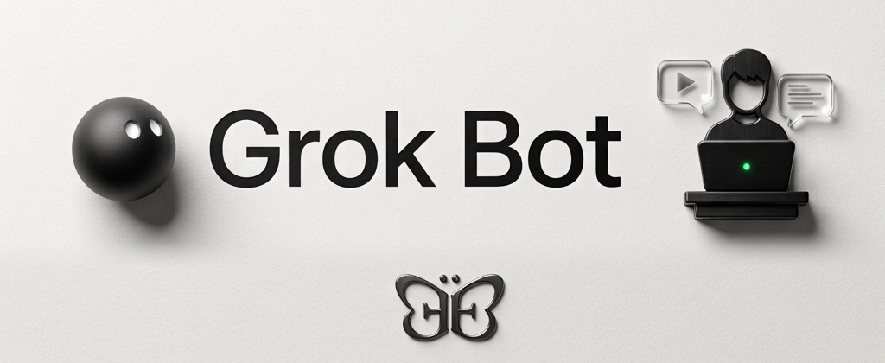

# Grok Bot Content Engine



A customizable content team for TikTok, Instagram and YouTube. Give the coordinator one idea or voice note; three platform teams turn it into hooks, captions, titles, hashtags and copyable drafts. You choose what to film and publish manually.

One coordinator, twelve specialists, three team chats and one standalone thumbnail bot. The architecture stays the same for every niche. Your identity, audience, voice, pillars, schedule and goals come from one local profile.

## Set up with Grok Bot

Give your bot the [repository link](https://github.com/evyevans/content-engine-grokbot) and send this message:

> Set up the Grok Bot Content Engine from https://github.com/evyevans/content-engine-grokbot for me. First, read the README and `skills/setup-content-engine/SKILL.md`, then follow that skill. Make the repository files available on your shared computer. Ask only for missing context, use my niche and audience, and verify the installation before enabling routines. Use only resources belonging to this deployment. I will review and publish content myself.

If you prefer, clone or download the repository yourself and attach the folder or place it on the bot's shared computer. The bot needs access to the actual project files, not just this README. The preparation scripts require Python 3.10+ with IANA time-zone data.

### What happens during setup

1. **Share your context.** The bot asks for your niche, audience, IANA time zone, and three ordered local times for a check-in, a nudge and an idea offer. Choose daily or weekdays. You can also provide your brand, voice, content pillars, handles, goals and production constraints. Unknown details stay unknown.
2. **Prepare your team.** The bot follows the setup skill to create or explicitly select the coordinator, twelve specialists and standalone IG Thumbnail bot, plus three platform group chats. It records resource IDs locally, generates instructions from your profile and checks membership and access. If its actual tools cannot complete a step, it should explain the manual step and verify the result afterward.
3. **Keep routines paused while testing.** The bot checks saved routine owners, prompts, local times, days and time zone. Optional comments/research and analytics phases are enabled only if you choose them. If a capability such as detecting a prior reply is unavailable, unattended routines that depend on it stay disabled and setup is reported as incomplete.

The setup skill uses the tools actually available in your account; it is not an external Grok Bot API client. This release has local automated tests, but **complete provisioning and model behavior have not yet been verified in a live Grok Bot account**. The live acceptance run is essential.

### Test the complete workflow

With routines paused, give the coordinator a safe example idea. Check the actual messages and files:

- A vague idea gets one clarifying question. The coordinator sends summaries to the appropriate teams; different platform ideas remain in their own chats.
- Each team works in order and its lead posts one platform draft in that team's chat, with copyable text in fenced blocks. Internal CTA numbers and logs do not appear in your draft.
- An edit request goes to the relevant team lead. When a team does not deliver, the coordinator follows the documented fallback without duplicating an existing deliverable.
- The thumbnail bot returns a real 1080 × 1920 JPEG with your chosen brand signature or no signature. You select the cover and post manually.
- Unknown statistics, handles and eligibility remain unknown. No bot publishes to a social account on your behalf.

Also test no-reply behavior, CTA rotation, schedule readback, and any optional phases you selected. The complete [live acceptance checklist](skills/setup-content-engine/references/acceptance.md) has the exact cases and evidence to record. Enable the selected routines only after the required checks pass in your account. If anything is unsupported or fails, keep affected routines inactive and resolve or document the missing step.

## What you customize

Copy `config/user.example.json` to ignored `config/user.json`, or let the setup skill do it. Supply niche, audience, IANA time zone and three ordered daily routine times; choose daily or weekdays. Defaults: display name User, coordinator Content Coordinator, clear practical voice, optional facts unknown. Phase 2 (comments/research) and Phase 3 (analytics) are opt-in. There is no assumed follower target, fixed deadline, personal baseline or account eligibility.

- [Start here](00_README_START_HERE.md): workflow and user experience.
- [Deployment guide](02_DEPLOYMENT_GUIDE.md): setup, updates, recovery and portability.
- [Master rules](01_MASTER_CONFIG.md): authoritative source; the deployment copy resolves your profile.
- [Architecture](architecture/README.md): the same ten layers, with configurable context.
- [Examples](examples/): illustrative sessions, never seeded history.

## Local preparation and checks

Python 3.10+ with IANA time-zone data is required for the stdlib preparation scripts. On systems without time-zone data install `tzdata`. Thumbnail rendering additionally needs Pillow and NumPy; `bash tools/thumbnail/setup.sh` creates its environment. The optional cut-out model uses a separate requirements file.

```sh
python3 scripts/verify.py --mode template
python3 -m unittest discover -s tests -v
python3 scripts/release.py --output /tmp/grok-bot-content-engine.zip
```

Tests for images use the current Python interpreter; install `tools/thumbnail/requirements.txt` in that environment first. Profile generation and journal tests need no model credentials or network. `python3 bot_profiles/_build_profiles.py` rebuilds committed neutral previews. Never install these unbound previews as a working deployment.

Personal profiles, IDs, generated deployments and logs belong in ignored `.local/<instance>/` (or `config/user.json`). Releases use an explicit allowlist, not everything in the folder. The MIT license covers project code and instructions; [third-party notices](THIRD_PARTY_NOTICES.md) cover bundled fonts. This is a community template, not an official product integration. Grok Bot access and usage depend on your provider's plan; no free-service claim is made.
